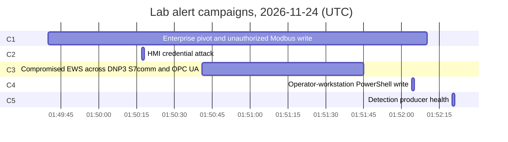

# Lab alert-flood analysis

Generated by `analysis/lab_case_study.py` from a pinned lab snapshot. Do not edit by hand; run `make case-study`.

## Provenance

| Field | Value |
| :--- | :--- |
| Snapshot | `lab-2026-11-24` |
| Lab repository | https://github.com/LiamCarPer/OT-Security-Lab |
| Lab commit | `df9fae4799b56a7aad7338967421ee4b0430cdda` |
| Captured | 2026-11-24T01:49:40.394101Z → 2026-11-24T01:52:20.686022Z |
| Timezone | UTC (the lab containers emit naive UTC timestamps) |

## At a glance

| Metric | Value |
| :--- | ---: |
| Raw alerts | 151 |
| Alert types | 17 |
| Sources | 4 |
| Window | 2026-11-24T01:49:40.394101Z → 2026-11-24T01:52:20.686022Z (160.292 s) |
| Episodes (60 s window) | 24 |
| Duplicate ratio | 0.8411 |
| Campaigns | 5 |
| Alerts per campaign | 30.2 |

## Campaigns

| ID | Source | Campaign | Raw | Episodes | Techniques | Window (s) |
| :-- | :-- | :-- | --: | --: | :-- | --: |
| C1 | 172.24.0.10 | Enterprise pivot and unauthorized Modbus write | 109 | 10 | T0831, T0836, T0846, T0886 | 150.259 |
| C2 | 172.24.0.30 | HMI credential attack | 3 | 1 | T0859 | 0.0 |
| C3 | 172.23.0.20 | Compromised EWS across DNP3, S7comm and OPC UA | 34 | 11 | T0816, T0843, T0845, T0846, T0858, T0869, T0871, T0878, T0888, T1692.001 | 64.064 |
| C4 | 172.22.0.30 | Operator-workstation PowerShell write | 4 | 1 | T0831 | 0.033 |
| C5 | — | Detection producer health | 1 | 1 | T0881 | 0.0 |

## Alert types

| Alert type | Raw | Episodes | Sources | Duplicate ratio |
| :-- | --: | --: | --: | --: |
| CROSS_ZONE_VIOLATION | 74 | 6 | 1 | 0.9189 |
| UNAUTHORIZED_MODBUS_WRITE | 27 | 2 | 2 | 0.9259 |
| PROCESS_SAFETY_VIOLATION | 7 | 1 | 1 | 0.8571 |
| DNP3_UNAUTHORIZED_CONTROL | 6 | 1 | 1 | 0.8333 |
| S7COMM_PROGRAM_DOWNLOAD | 6 | 1 | 1 | 0.8333 |
| S7COMM_PROGRAM_UPLOAD | 6 | 1 | 1 | 0.8333 |
| OT_BRUTE_FORCE_SCAN | 4 | 1 | 1 | 0.75 |
| S7COMM_CHANGE_OPERATING_MODE | 4 | 1 | 1 | 0.75 |
| HMI_LOGIN_FAILURE | 3 | 1 | 1 | 0.6667 |
| DNP3_RESTART_COMMAND | 2 | 1 | 1 | 0.5 |
| DNP3_UNSOLICITED_DISABLED | 2 | 1 | 1 | 0.5 |
| OPCUA_BROWSE_REQUEST | 2 | 1 | 1 | 0.5 |
| OPCUA_WRITE_REQUEST | 2 | 1 | 1 | 0.5 |
| OPCUA_METHOD_CALL | 2 | 1 | 1 | 0.5 |
| OT_PORT_SCAN | 2 | 2 | 2 | 0.0 |
| C2_BEACON | 1 | 1 | 1 | 0.0 |
| DETECTION_SERVICE_DOWN | 1 | 1 | 1 | 0.0 |

## Timeline



## SIEM lifecycle (secondary)

This is the firing/resolved log, not the 160-second burst. It spans a different period and is included for alert-lifecycle realism, not for the campaign count.

| Metric | Value |
| :--- | ---: |
| Rows | 364 |
| Window | 2026-08-01T10:08:07.193407Z → 2026-11-24T01:58:08.088494Z |
| Firing / resolved | 305 / 59 |

Top alert names: `ProcessSafetyViolation` (64), `UnauthorizedModbusWrite` (55), `ModbusExceptionFlood` (36), `CrossZoneViolation` (36), `Industrial_Protocol_Traffic_From_Enterprise_To_Control_Zone` (25), `DNP3_Unsolicited_Responses_Disabled` (19), `DNP3_Control_Operation_From_Unauthorized_Master` (19), `DNP3_Cold_Or_Warm_Restart_Command` (19), `OPC_UA_Address_Space_Browse` (19), `OPC_UA_Write_Request` (19)

## Recorded runtime totals (different run)

The lab's runtime evidence file is an aggregate from an earlier run, not the 160-second snapshot. It is cited only as corroboration of scale.

| Metric | Value |
| :--- | ---: |
| Captured | 2026-10-25T01:01:45Z |
| Alerts | 581 |
| Types | 17 |
| Sources | 4 |

## Reproduce

```bash
make case-study
```

`--check` fails when this report, the summary or the rule-health seed differs from a fresh run.
